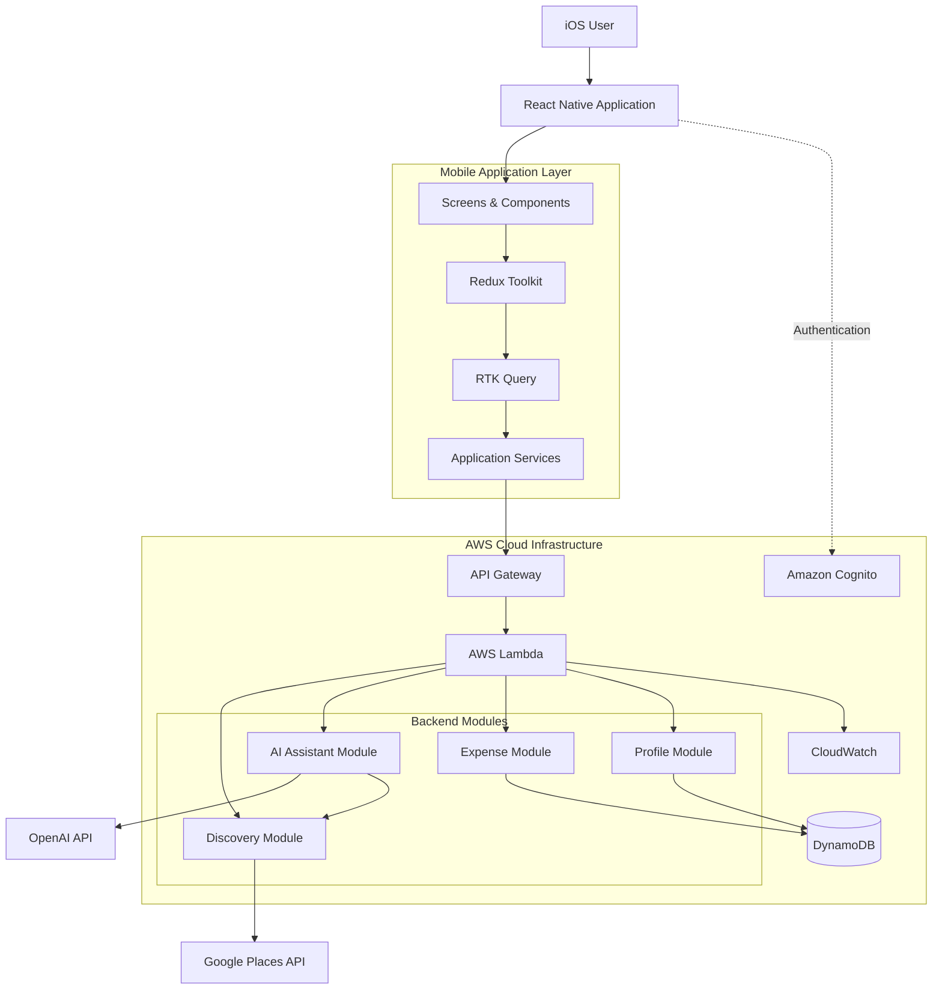
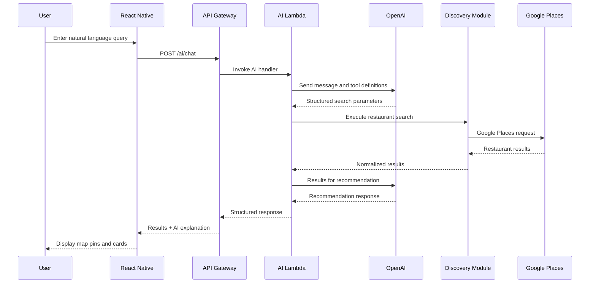
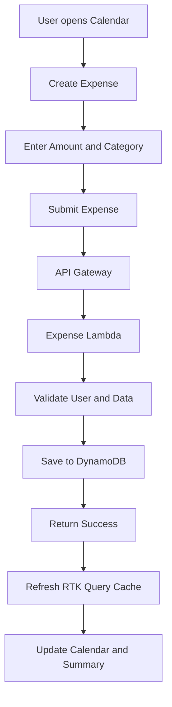

# Food Discovery App — System Architecture

**Version:** 1.0  
**Platform:** iOS First  
**Mobile:** React Native + TypeScript  
**Backend:** AWS Serverless  
**AI:** OpenAI API  
**Restaurant Data:** Google Places API

---

## 1. Product Overview

The application is an AI-powered food discovery and personal food expense tracking platform.

Its primary objective is to reduce the time users spend deciding what to eat by combining location-based restaurant discovery, natural language search, and personalized recommendations.

### Core Features

| Module               | Description                                            | Priority |
| -------------------- | ------------------------------------------------------ | -------- |
| Food Discovery       | Discover nearby restaurants using an interactive map   | P0       |
| AI Food Assistant    | Search restaurants through natural language            | P0       |
| Search Filters       | Filter by distance, rating, category and budget        | P0       |
| Restaurant Details   | Display restaurant information, ratings and navigation | P0       |
| Food Expense Tracker | Record daily food expenditure                          | P1       |
| Calendar             | Display daily and monthly spending                     | P1       |
| User Profile         | Manage preferences and account information             | P1       |
| Group Dining         | Receipt OCR and collaborative bill splitting           | Future   |

### Product Principles

1. Discovery must work without requiring AI interaction.
2. Restaurant information must originate from real data providers.
3. AI should interpret user intent and improve recommendations, not fabricate restaurant information.
4. Users should be able to browse restaurants without creating an account.
5. Personal expense records should be synchronized securely.
6. The backend should remain modular enough to support future features without requiring a major architectural rewrite.

---

## 2. Technology Stack

### 2.1 Mobile Application

| Technology               | Responsibility                             |
| ------------------------ | ------------------------------------------ |
| React Native             | Cross-platform mobile framework, iOS-first |
| TypeScript               | Static typing                              |
| Redux Toolkit            | Global application state                   |
| RTK Query                | API requests and caching                   |
| React Navigation         | Navigation and bottom tabs                 |
| react-native-maps        | Interactive map                            |
| React Native Geolocation | Location access                            |
| React Hook Form          | Form management                            |
| Zod                      | Runtime validation                         |

### 2.2 Backend Infrastructure

| AWS Service        | Responsibility               |
| ------------------ | ---------------------------- |
| Amazon API Gateway | HTTP API entry point         |
| AWS Lambda         | Backend business logic       |
| Amazon Cognito     | User authentication          |
| Amazon DynamoDB    | Application database         |
| Amazon CloudWatch  | Logs and monitoring          |
| Amazon S3          | Future receipt image storage |

### 2.3 External Services

| Provider                 | Responsibility                                     |
| ------------------------ | -------------------------------------------------- |
| OpenAI API               | Natural language understanding and recommendations |
| Google Places API        | Restaurant discovery, ratings and business details |
| Apple Maps / Google Maps | Map rendering and navigation                       |

**Infrastructure principle:** Start with a serverless architecture. Avoid EC2, ECS, EKS, RDS and other infrastructure that introduces unnecessary operational overhead for the initial product.

---

## 3. High-Level System Architecture



### Architecture Explanation

The mobile application communicates with AWS through API Gateway.

API Gateway routes incoming requests to Lambda functions, which execute the corresponding business logic.

The backend is divided into logical modules:

- Discovery: Restaurant search and filtering.
- AI Assistant: Natural language processing and recommendation orchestration.
- Expense: Personal food expenditure management.
- Profile: User preferences and settings.

The application uses external APIs for restaurant information and AI capabilities.

DynamoDB stores user-related information and expense records. Restaurant search results are retrieved from Google Places rather than treated as the application's primary database.

---

## 4. Mobile Application Architecture

### 4.1 Navigation Structure

The initial application will contain four bottom navigation destinations.

| Tab      | Responsibility                                  |
| -------- | ----------------------------------------------- |
| Explore  | Map, AI chat and restaurant discovery           |
| Calendar | Food spending and expense history               |
| Activity | Saved restaurants and recent discovery activity |
| Profile  | Account, preferences and settings               |

Group Dining is intentionally excluded from the initial navigation.

It can be introduced as a separate module in a future release.

### 4.2 Suggested Project Structure

```text
src/
├── app/
│   ├── store.ts
│   ├── rootReducer.ts
│   └── hooks.ts
│
├── navigation/
│   ├── RootNavigator.tsx
│   └── TabNavigator.tsx
│
├── features/
│   ├── discovery/
│   │   ├── screens/
│   │   ├── components/
│   │   ├── hooks/
│   │   ├── discoverySlice.ts
│   │   ├── discoveryApi.ts
│   │   └── types.ts
│   │
│   ├── aiAssistant/
│   │   ├── components/
│   │   ├── aiSlice.ts
│   │   ├── aiApi.ts
│   │   └── types.ts
│   │
│   ├── expenses/
│   │   ├── screens/
│   │   ├── components/
│   │   ├── expenseSlice.ts
│   │   ├── expenseApi.ts
│   │   └── types.ts
│   │
│   ├── calendar/
│   │   ├── screens/
│   │   └── components/
│   │
│   ├── profile/
│   │   ├── screens/
│   │   ├── profileSlice.ts
│   │   └── profileApi.ts
│   │
│   └── auth/
│       ├── screens/
│       └── authService.ts
│
├── services/
│   ├── apiClient.ts
│   ├── locationService.ts
│   ├── mapService.ts
│   └── storageService.ts
│
├── components/
│   ├── common/
│   └── layout/
│
├── constants/
├── hooks/
├── utils/
└── types/
```

### 4.3 State Management Strategy

Redux Toolkit should manage application-wide state, but not every UI interaction.

| State                     | Management            |
| ------------------------- | --------------------- |
| Current location          | Discovery state       |
| Search radius             | Discovery state       |
| Active filters            | Discovery state       |
| Restaurant search results | RTK Query cache       |
| AI conversation           | AI Assistant state    |
| User preferences          | Profile state         |
| Expense records           | RTK Query cache       |
| Modal visibility          | Local component state |
| Form inputs               | Local form state      |

**Important:** Avoid duplicating API response data in both Redux slices and RTK Query caches.

RTK Query should be the primary owner of server data.

---

## 5. Backend Architecture

### 5.1 API Gateway

API Gateway acts as the public entry point for backend requests.

All protected endpoints should validate the Cognito access token through an appropriate authorizer.

Suggested initial API routes:

| Method | Endpoint               | Responsibility                    |
| ------ | ---------------------- | --------------------------------- |
| POST   | /ai/chat               | Process natural language requests |
| GET    | /restaurants/search    | Search nearby restaurants         |
| GET    | /restaurants/{placeId} | Retrieve restaurant details       |
| GET    | /users/me              | Retrieve user profile             |
| PATCH  | /users/me              | Update user preferences           |
| GET    | /expenses              | Retrieve expenses                 |
| POST   | /expenses              | Create expense                    |
| PATCH  | /expenses/{expenseId}  | Update expense                    |
| DELETE | /expenses/{expenseId}  | Delete expense                    |
| GET    | /expenses/summary      | Retrieve spending summaries       |

Anonymous discovery endpoints should be supported without Cognito authentication.

Expense and profile endpoints must require authentication.

### 5.2 Lambda Modules

Organize backend logic by business responsibility.

**Discovery Module**

- Validate search parameters.
- Retrieve restaurant information.
- Apply supported filters.
- Normalize restaurant responses.
- Return results to the mobile application.

**AI Assistant Module**

- Receive user messages.
- Understand search intent.
- Extract search parameters.
- Invoke discovery operations.
- Generate recommendation explanations.
- Return structured responses.

**Expense Module**

- Create, update and delete expenses.
- Retrieve historical records.
- Calculate daily and monthly totals.
- Validate ownership of expense records.

**Profile Module**

- Retrieve user preferences.
- Update radius and language settings.
- Store dietary preferences.
- Manage account-related application settings.

For the MVP, these modules can share a small number of Lambda deployments. They do not need to become independent microservices.

---

## 6. AI Food Assistant Architecture

This is the most important technical component of the application.

### 6.1 Design Principle

OpenAI must not be treated as a restaurant search engine.

The AI model is responsible for interpreting natural language and deciding which search operation should be executed.

Google Places is responsible for providing real restaurant information.

### 6.2 Search Flow

Example user request:

"Find me a cafe within 3km, rated above 4 stars, with food below RM20."

Processing flow:



### 6.3 AI Tool Definition

Example search parameters:

```json
{
  "category": "cafe",
  "radius": 3000,
  "minRating": 4.0,
  "maxBudget": 20,
  "currency": "MYR",
  "location": {
    "latitude": 3.0,
    "longitude": 101.0
  }
}
```

The coordinates above are illustrative only.

The backend should use the location supplied by the client after validation.

### 6.4 Important AI Considerations

- Use OpenAI function calling / tool calling.
- Validate all generated parameters using a schema.
- Restrict the model to explicitly defined tools.
- Do not allow the model to execute arbitrary URLs or code.
- Keep OpenAI API credentials on the backend.
- Limit conversation history to relevant context.
- Avoid calling OpenAI for ordinary filter changes.
- Handle cases where no restaurants match the criteria.

### 6.5 Budget Accuracy

Google Places does not guarantee exact menu prices.

Therefore:

- Rating filters can use actual provider ratings.
- Radius filters can use geographic distance.
- Category filters can use supported place categories.
- Budget filters must be treated as estimates unless verified menu data is available.

The application should never present an estimated RM20 meal as a confirmed price.

---

## 7. Database Design

Use Amazon DynamoDB for persistent application data.

For the initial version, use a small number of tables rather than introducing a complicated single-table design prematurely.

### 7.1 Users Table

**Table: Users**

| Attribute          | Type        | Description           |
| ------------------ | ----------- | --------------------- |
| userId             | String (PK) | Cognito subject       |
| email              | String      | User email            |
| displayName        | String      | Display name          |
| language           | String      | Preferred language    |
| defaultRadius      | Number      | Default search radius |
| dietaryPreferences | List        | Food preferences      |
| createdAt          | String      | Account creation date |
| updatedAt          | String      | Last update           |

### 7.2 Expenses Table

**Table: Expenses**

| Attribute      | Type            | Description               |
| -------------- | --------------- | ------------------------- |
| expenseId      | String (PK)     | Unique expense identifier |
| userId         | String (GSI PK) | Expense owner             |
| expenseDate    | String (GSI SK) | Expense date              |
| amount         | Number          | Expense amount            |
| currency       | String          | MYR                       |
| category       | String          | Lunch / Dinner / Cafe     |
| description    | String          | Optional description      |
| restaurantName | String          | Optional restaurant       |
| createdAt      | String          | Creation timestamp        |

Recommended access pattern:

- Retrieve expenses belonging to a user.
- Retrieve expenses within a date range.
- Calculate monthly expenditure.
- Retrieve a specific expense.

Use a GSI on userId and expenseDate for efficient user/date queries.

Store monetary values as integer minor units (sen) rather than floating-point values. For example, RM12.50 should be stored as 1250.

### 7.3 Restaurant Data

Restaurant search results should not initially be stored permanently in DynamoDB.

Use Google Places as the source of truth and follow its caching and storage policies.

The mobile application can maintain short-lived RTK Query caches for search results.

### 7.4 Future Group Dining Data

The architecture can later introduce:

- Groups
- GroupMembers
- Receipts
- ReceiptItems
- ItemAssignments
- PaymentRecords

These entities are not required for the MVP.

The future group module should integrate with the existing expense module through a controlled expense-creation interface.

---

## 8. Location and Map Architecture

### 8.1 Location Flow

1. User opens Explore.
2. Application requests foreground location permission.
3. Device returns current coordinates.
4. Map centers around the user's location.
5. User adjusts the search radius.
6. Application queries nearby restaurants.
7. Results appear as map pins and restaurant cards.

### 8.2 Radius Management

Suggested default:

- 1km
- 3km
- 5km
- 10km
- Custom radius

Search radius should be stored as a user preference when authenticated.

### 8.3 Location Privacy

- Request foreground location permission only.
- Do not track users continuously in the background.
- Allow manual location selection.
- Send coordinates only when needed for restaurant searches.
- Avoid storing location history unless a future feature requires it.

---

## 9. Expense Tracking Architecture

The expense module is intentionally independent of the discovery module.

Users should be able to create an expense manually without first selecting a restaurant.

### Expense Creation Flow



### Calendar Requirements

- Monthly calendar view.
- Daily expense totals.
- Daily expense breakdown.
- Monthly expenditure.
- Average daily expenditure.
- Category breakdown.
- Optional monthly spending target.

The calendar should retrieve data from the expense API rather than calculating financial totals exclusively on the client.

---

## 10. Security and Reliability

### Authentication

Amazon Cognito User Pools will handle user authentication.

Potential authentication methods:

- Sign in with Apple.
- Email authentication.
- Guest access for restaurant discovery.

Guest access should not require creating a Cognito account.

### API Security

- Cognito authorizer for protected endpoints.
- Input validation on every backend operation.
- User ownership validation before accessing expense records.
- Rate limiting and throttling.
- API keys restricted to their intended mobile application use.
- Secrets stored in AWS Secrets Manager or an equivalent secure configuration mechanism.

### API Key Management

Never expose these credentials in the React Native bundle:

- OpenAI API key.
- Google Places Web Service API key.
- AWS secret credentials.

Google Maps SDK keys used by the native mobile application should be separately restricted by platform and application identity.

### Monitoring

Use CloudWatch for:

- Lambda execution logs.
- API Gateway errors.
- Request latency.
- External API failures.
- AI request failures.
- DynamoDB errors.

Avoid logging sensitive personal information or complete user conversations unnecessarily.

---

## 11. Deployment Architecture

Recommended environments:

| Environment | Purpose                       |
| ----------- | ----------------------------- |
| Development | Local development and testing |
| Staging     | Integration testing           |
| Production  | Live application              |

Recommended deployment tools:

- AWS CDK or AWS SAM for Infrastructure as Code.
- GitHub Actions for CI/CD.
- Expo EAS or an appropriate React Native build pipeline for iOS builds.
- AWS CloudWatch for operational monitoring.

Infrastructure should be reproducible through code rather than configured manually in the AWS Console.

---

## 12. Development Roadmap

### Phase 1 — Foundation

- Initialize React Native TypeScript project.
- Configure Redux Toolkit.
- Implement navigation.
- Set up Cognito.
- Set up API Gateway and Lambda.
- Configure DynamoDB.
- Implement basic profile management.

### Phase 2 — Food Discovery

- Integrate map SDK.
- Implement foreground location permission.
- Implement radius selection.
- Integrate Google Places API.
- Display restaurant pins.
- Build restaurant detail view.
- Implement search filters.

### Phase 3 — AI Assistant

- Integrate OpenAI API through backend.
- Implement function calling.
- Parse natural language search queries.
- Connect AI tools to restaurant discovery.
- Display recommendations.
- Implement conversation history.

### Phase 4 — Personal Expense Tracker

- Expense CRUD.
- Calendar view.
- Monthly summaries.
- Category breakdown.
- Spending insights.

### Phase 5 — Polish and Release

- Performance optimization.
- Error handling.
- Analytics.
- App Store preparation.
- Beta testing.
- Production deployment.

### Future Phase — Group Dining

- Receipt image upload.
- OCR extraction.
- Collaborative receipt assignment.
- Tax and service charge calculations.
- Payment status.
- Shared expense integration.

---

## 13. Architecture Decisions and Trade-offs

| Decision                          | Reason                                                        |
| --------------------------------- | ------------------------------------------------------------- |
| AWS Serverless                    | Minimal infrastructure management                             |
| DynamoDB                          | Fits user preferences and expense records                     |
| OpenAI API                        | Natural language interpretation                               |
| Google Places                     | Real-world restaurant discovery                               |
| Redux Toolkit                     | Centralized client state                                      |
| RTK Query                         | API caching and request lifecycle                             |
| No dedicated backend server       | Avoid unnecessary hosting costs                               |
| No group infrastructure initially | Reduce MVP complexity                                         |
| No restaurant database initially  | Avoid unnecessary data duplication and provider policy issues |

### Important Limitations

1. Google Places API pricing and field availability must be evaluated before launch.
2. Restaurant prices may not be available as exact menu prices.
3. AI recommendations depend on the quality of retrieved restaurant data.
4. Serverless infrastructure still requires cost monitoring and rate limiting.
5. DynamoDB data access patterns should be validated against actual application queries before finalizing indexes.

---

## 14. Final Architecture Direction

The first release should focus on two independent but complementary experiences:

**Food Discovery**

Help users decide what to eat through location-aware search, AI-assisted filtering and restaurant recommendations.

**Personal Food Tracking**

Help users understand their daily and monthly food expenditure through expense records and calendar visualization.

Group Dining is a future extension, not an MVP dependency.

The architecture should prioritize simplicity, security, low operational overhead and clear separation of responsibilities.

**Core philosophy: Build a useful food discovery product first. Expand into a broader food companion only after validating actual user behaviour.**
